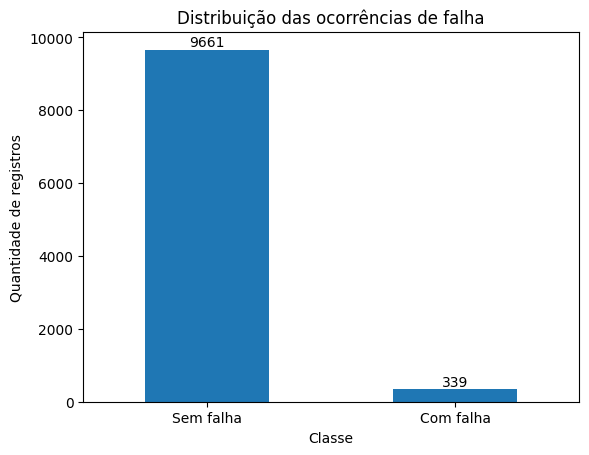
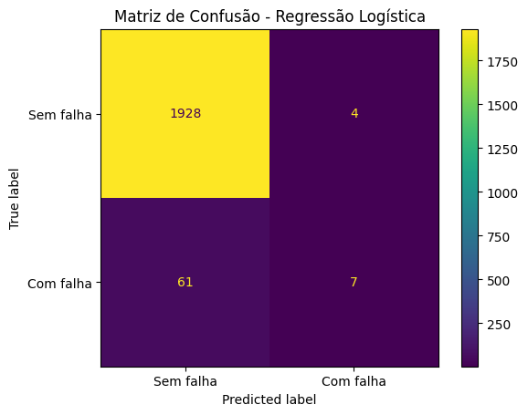
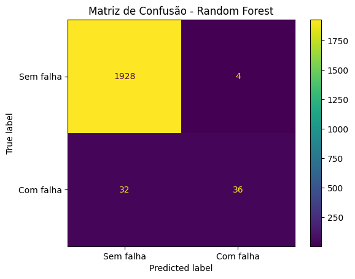
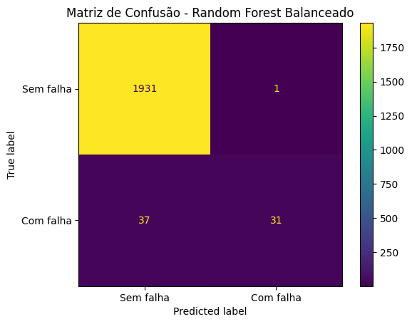

# MVP — Sistema de Suporte à Decisão para Manutenção Preditiva

**Disciplina:** Sistemas de Suporte à Decisão — Engenharia de Produção, Universidade de Brasília (UnB)  
**Autor:** Ricardo Pimentel André  
**Estado:** MVP demonstrativo em Python; pipeline de dados em nuvem e integração executados e documentados em 09/11/2026. **Não é sistema implantado em indústria.**

## 1. Problema e objetivo

Equipes de manutenção precisam decidir quais condições operacionais merecem avaliação prioritária. Este MVP usa seis atributos de operação para **classificar a ocorrência de falha** e apresentar uma orientação textual de **priorizar avaliação** ou **manter acompanhamento**, sem substituir o julgamento técnico.

O projeto original foi desenvolvido como notebook de classificação. As quatro perguntas abaixo foram **formalizadas retrospectivamente em 09/11/2026**, depois da escolha da base e dos modelos; **não foram registradas antes do experimento**. A hipótese retrospectivamente expressa é que essas seis entradas permitem identificar parte das falhas e gerar sinais para triagem humana, mas não validam intervenção automática.

| Pergunta de negócio | Resposta verificada | Significado para a decisão |
|---|---|---|
| **P1.** Qual é a frequência de falhas? | **339/10.000 (3,39%)** | A classe de falha é rara; não avaliar apenas pela acurácia. |
| **P2.** Qual configuração obteve maior F1 para falhas nesta partição? | **Random Forest sem balanceamento: 0,667** | Candidato para a demonstração, **não** superioridade geral. |
| **P3.** Quantas falhas foram identificadas ou perdidas? | **36 de 68** identificadas; **32** não identificadas; **4** falsos alertas. | Um alerta positivo pode orientar triagem; resultado negativo **não garante segurança**. |
| **P4.** Qual orientação é apresentada? | Classe 1 → priorizar avaliação; classe 0 → manter acompanhamento. | A decisão final cabe à equipe de manutenção. |

Interpretações, fontes e limites de cada pergunta: [perguntas de negócio e apoio à decisão](docs/perguntas_negocio_apoio_decisao.md).

## 2. Dados e licença

- **Fonte:** [AI4I 2020 Predictive Maintenance Dataset](https://archive.ics.uci.edu/dataset/601/ai4i+2020+predictive+maintenance+dataset), UCI Machine Learning Repository, ID 601, DOI [10.24432/C5HS5C](https://doi.org/10.24432/C5HS5C).
- **Licença da base:** [Creative Commons Attribution 4.0 (CC BY 4.0)](https://creativecommons.org/licenses/by/4.0/); atribuição à fonte necessária. A licença dos **dados não equivale** à licença do código do projeto.
- **Natureza:** dados **sintéticos**, não provenientes de sensores de uma fábrica real.
- **Coleta persistida e verificada:** 09/11/2026, via `fetch_ucirepo(id=601)`, usando Google Colab e Google Drive; dados serializados como **CSV UTF-8**.
- **Bronze:** 10.000 linhas × 14 colunas, correspondentes ao DataFrame recebido via `ucimlrepo` e salvo em CSV (não é cópia byte a byte do CSV distribuído pela UCI).
- **Prata:** 10.000 linhas × 7 colunas, sendo seis entradas e o alvo `Machine failure`: `Type`, `Air temperature` (K), `Process temperature` (K), `Rotational speed` (rpm), `Torque` (Nm), `Tool wear` (min) e `Machine failure` (0/1).

Os IDs e os cinco indicadores dos modos de falha permanecem na bronze e **não são entradas do classificador**. O modelo de dados é **flat** (tabela única); não foi criado esquema estrela. Ver [catálogo, regras, modelo e linhagem](docs/modelo_catalogo_linhagem.md).

## 3. Pipeline na nuvem

```text
UCI AI4I 2020 (id=601)
    → Google Colab: coleta via ucimlrepo
    → Google Drive: bronze (14 colunas)
    → seleção das 6 entradas e do alvo, sem excluir registros
    → Google Drive: prata (7 colunas)
    → releitura da prata e verificação do SHA-256
    → Colab: divisão 80/20, pré-processamento e três modelos
    → classificador selecionado → resultado e recomendação textual
```

Na execução de 09/11/2026, as camadas **bronze e prata foram gravadas e relidas** do Google Drive. A etapa de integração treinou os três modelos **a partir da prata relida**, sem fazer nova coleta na UCI. O relatório da integração registra conferência do SHA-256 e reprodução das métricas e dos dois exemplos de orientação.

**Limite de reprodutibilidade:** o notebook de **ETL/coleta e carga está versionado** em [`notebooks/ETL_MVP_SSD_Colab_GoogleDrive.ipynb`](notebooks/ETL_MVP_SSD_Colab_GoogleDrive.ipynb). O notebook integrado utiliza caminho e SHA-256 **fixos** da execução do autor no Drive; terceiros precisam executar o ETL na própria conta e **ajustar o caminho e o hash** no notebook integrado para usar seu CSV gerado. Portanto, a execução original está documentada, mas a reprodução ponta a ponta **não é automática nem portátil** sem essas adaptações. Os CSVs permanecem no Drive do projeto; não estão incluídos no repositório.

## 4. Método de classificação

- **Divisão estratificada:** 80% para treino (8.000 observações) e 20% para teste (2.000), com `random_state=42`. No teste: 68 falhas e 1.932 casos sem falha.
- **Regressão Logística:** codificação one-hot da variável `Type` e padronização das variáveis numéricas; `max_iter=1000`.
- **Random Forest:** one-hot da variável `Type`, 100 árvores, sem padronização numérica.
- **Random Forest balanceado:** mesma configuração, adicionando `class_weight="balanced"`.
- **Implementação:** `scikit-learn` e pipelines de pré-processamento ajustados no conjunto de treino.

**Limitação metodológica central:** a configuração foi escolhida a partir das métricas da **mesma partição de teste** usada para reportar o desempenho. Não houve validação final independente, validação cruzada, ajuste sistemático de hiperparâmetros, calibração dos escores ou comparação de custos reais de manutenção.

### Resultados reproduzidos

| Modelo | Acurácia | Precisão (falha) | Recall (falha) | F1 (falha) |
|---|---:|---:|---:|---:|
| Regressão Logística | 0,968 | 0,636 | 0,103 | 0,177 |
| **Random Forest** | **0,982** | 0,900 | **0,529** | **0,667** |
| Random Forest balanceado | 0,981 | **0,969** | 0,456 | 0,620 |

Matrizes de confusão do teste, na ordem **[[VN, FP], [FN, VP]]**:

| Modelo | VN | FP | FN | VP |
|---|---:|---:|---:|---:|
| Regressão Logística | 1.928 | 4 | 61 | 7 |
| Random Forest | 1.928 | 4 | 32 | 36 |
| Random Forest balanceado | 1.931 | 1 | 37 | 31 |

Nesta partição, o Random Forest sem balanceamento atingiu maior F1-score da classe positiva, mas **não identificou 32 das 68 falhas (47,1%)**. Os resultados valem para este experimento e ambiente, não para sistemas industriais reais.

**Figuras extraídas das saídas já salvas no notebook original (agosto/2026):**



| Regressão Logística | Random Forest | Random Forest balanceado |
|---|---|---|
|  |  |  |

As figuras acima **não são capturas da execução de integração no Colab**; para essa execução, o registro disponível é o [relatório JSON validado](evidencias/relatorio_integracao_mvp.json).

**Reprodução de ambiente:** em 09/11/2026, os resultados acima foram reproduzidos no Colab com **Python 3.13.18** e **scikit-learn 1.8.0**, usando a fonte oficial da UCI; as outras versões constam em [`requirements.txt`](requirements.txt) e no [relatório de reprodução](evidencias/relatorio_reproducao_ssd.json). **Não é conhecida a versão do scikit-learn usada na execução original de agosto/2026**. O desempenho do Random Forest balanceado pode variar em outras versões.

## 5. Saída do SSD

A função `avaliar_maquina` recebe as seis entradas e utiliza o Random Forest para classificar a observação:

- **Classe 1:** exibe “POSSÍVEL FALHA IDENTIFICADA” e recomenda **priorizar a avaliação da condição pela equipe de manutenção**.
- **Classe 0:** exibe “NÃO FOI IDENTIFICADA FALHA” e recomenda **manter o acompanhamento das condições operacionais**.

A função também mostra `predict_proba` como **escore do classificador**, e **não** como probabilidade real de falha calibrada. Os exemplos de **94%** (falha detectada) e **13%** (sem falha identificada) foram escolhidos **entre previsões corretas**, para demonstrar a função; não constituem validação independente. Não existe interface web, execução contínua em sensores ou disparo automático de manutenção.

## 6. Qualidade de dados e ressalvas

A análise da prata e da bronze persistidas no Drive documentou:

| Verificação | Resultado |
|---|---:|
| Valores nulos nos 7 campos da prata | **0** |
| Linhas integralmente duplicadas na prata | **0** |
| Células iguais entre as colunas correspondentes da bronze e da prata | **70.000/70.000** |
| Valores inválidos em domínios básicos das entradas | **0** |
| Divergências entre `Machine failure` e a combinação dos cinco modos da bronze | **27/10.000** |

Dessas 27 divergências, **9** têm alvo de falha igual a 1 sem nenhum modo marcado e **18** têm `RNF=1` com alvo 0. A diferença **já existia na bronze**, não foi criada pelo ETL. Não se alteraram os rótulos, pois isso mudaria o experimento de origem. Faixas numéricas listadas no catálogo são **limites observados**, não regras para novos equipamentos.

Consulte [catálogo e linhagem](docs/modelo_catalogo_linhagem.md) e [relatório de qualidade](evidencias/relatorio_qualidade_dados.json).

## 7. Como consultar e executar

**Para reproduzir o notebook original (UCI diretamente):**

1. Abra [`MVP_Manutencao_Preditiva.ipynb`](MVP_Manutencao_Preditiva.ipynb) no Google Colab.
2. Use ambiente compatível com Python 3.13 e as versões de [`requirements.txt`](requirements.txt); execute as células de cima a baixo e autorize o acesso à UCI, quando necessário.
3. Compare as saídas com [`evidencias/relatorio_reproducao_ssd.json`](evidencias/relatorio_reproducao_ssd.json).

**Para repetir a integração já comprovada (é necessário acesso à pasta do Drive do autor):**

1. Abra [`notebooks/Integracao_MVP_SSD_Drive_Modelos.ipynb`](notebooks/Integracao_MVP_SSD_Drive_Modelos.ipynb) no Colab e use a conta que tem acesso à execução de 09/11/2026.
2. Execute tudo, montando o Drive quando solicitado. O código verifica um caminho **fixo** e SHA-256 do CSV prata; falha se o arquivo não for o mesmo.
3. Confira as métricas e as recomendações; o relatório publicado é [`evidencias/relatorio_integracao_mvp.json`](evidencias/relatorio_integracao_mvp.json).

**Para reconstruir o fluxo inteiro a partir de zero:** execute [`notebooks/ETL_MVP_SSD_Colab_GoogleDrive.ipynb`](notebooks/ETL_MVP_SSD_Colab_GoogleDrive.ipynb) no Colab, autorizando sua conta do Drive. Em seguida, copie o caminho e o SHA-256 do CSV prata gerado para os parâmetros correspondentes de [`notebooks/Integracao_MVP_SSD_Drive_Modelos.ipynb`](notebooks/Integracao_MVP_SSD_Drive_Modelos.ipynb), antes de executar a integração. **A reprodução ponta a ponta demanda essa configuração manual e ainda não foi testada como fluxo portátil por terceiros.**

## 8. Estrutura e evidências

| Arquivo/pasta | Conteúdo |
|---|---|
| [`MVP_Manutencao_Preditiva.ipynb`](MVP_Manutencao_Preditiva.ipynb) | Notebook original, preservado |
| [`notebooks/ETL_MVP_SSD_Colab_GoogleDrive.ipynb`](notebooks/ETL_MVP_SSD_Colab_GoogleDrive.ipynb) | Coleta UCI, ETL, gravação bronze/prata no Drive e validação da carga |
| [`notebooks/Integracao_MVP_SSD_Drive_Modelos.ipynb`](notebooks/Integracao_MVP_SSD_Drive_Modelos.ipynb) | Leitura da prata no Drive, treino e orientação |
| [`docs/modelo_catalogo_linhagem.md`](docs/modelo_catalogo_linhagem.md) | Modelo flat, catálogo de sete campos, transformações e linhagem |
| [`docs/perguntas_negocio_apoio_decisao.md`](docs/perguntas_negocio_apoio_decisao.md) | Perguntas, respostas, decisões e limitações |
| [`requirements.txt`](requirements.txt) | Versões utilizadas na reprodução |
| [`evidencias/relatorio_etl_nuvem.json`](evidencias/relatorio_etl_nuvem.json) | Coleta, gravação, releitura e hashes de bronze/prata |
| [`evidencias/relatorio_qualidade_dados.json`](evidencias/relatorio_qualidade_dados.json) | Controles de qualidade e divergências da base |
| [`evidencias/relatorio_reproducao_ssd.json`](evidencias/relatorio_reproducao_ssd.json) | Reexecução controlada dos três modelos |
| [`evidencias/relatorio_integracao_mvp.json`](evidencias/relatorio_integracao_mvp.json) | Treino usando a prata do Drive e demonstrações |
| [`evidencias/`](evidencias/) | Duas capturas da presença dos CSVs bronze/prata no Drive, quatro gráficos exportados do notebook original e relatórios JSON da execução |

Os arquivos no Google Drive **não são públicos** por padrão. Os caminhos nos relatórios indicam a execução real; para auditar o acesso, é necessário ter permissão à conta/pasta correspondente. As capturas demonstram a presença dos arquivos, e os relatórios registram integridade, métricas e verificações.

## 9. Autoavaliação

**Quais perguntas foram respondidas?** P1–P4 foram respondidas com dados e saídas dos notebooks, conforme descrito na Seção 1. No entanto, elas foram formalizadas **após** a implementação original, de modo que não se comprova planejamento anterior ao experimento. Não foi comprovado impacto real nas decisões de usuários.

**Quais limitações dos dados afetam o resultado?** A base é sintética, a classe de falha é rara (3,39%), há 27 divergências entre o alvo e a combinação dos indicadores de modo de falha, e não há séries temporais de máquinas reais. O resultado em um único teste não mede desempenho industrial.

**O que seria feito de outra forma ao recomeçar?** Definir e registrar previamente as perguntas e critérios de aceitação; separar treino, validação e teste; controlar versões desde a primeira execução; versionar o ETL **desde o início** (ele foi publicado posteriormente) e preservar uma chave técnica estável na prata.

**O que falta para uso contínuo?** Tornar ETL/inferência reproduzíveis e automatizados, parametrizar o acesso à nuvem, validar com dados operacionais autorizados, estimar custos de falsos alarmes e falhas não identificadas, medir calibração, estabelecer monitoramento e governança e testar o fluxo com usuários reais. Nada disso foi validado em ambiente de produção.

**Consideração técnica:** a execução documentada usa recursos do Google Colab e Google Drive; não foi realizado levantamento financeiro para estimar o custo de operação em escala. Tampouco foi conduzido estudo de aceitação por usuários.

**Licenciamento:** o **código e a documentação autoral** deste repositório estão sob a [licença MIT](LICENSE), com aviso de copyright. **Os dados AI4I 2020 da UCI têm licença própria, CC BY 4.0**, que exige atribuição à fonte e não é substituída pela licença do código.

---

**Escopo comprovado:** pipeline bronze/prata no Drive, código do ETL versionado, análise de qualidade, reprodução dos classificadores e demonstração integrada de apoio à decisão em Colab.  
**Escopo não comprovado:** prevenção real de falhas, superioridade geral de algoritmo, implantação industrial e reprodução automática e sem adaptação em contas de terceiros.
